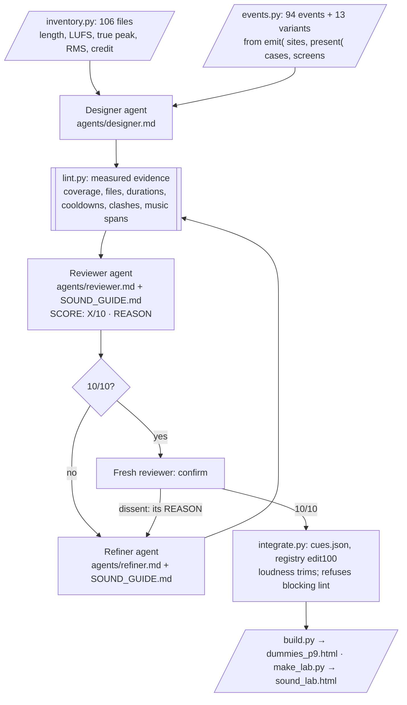

# DUMMIES — Sound Designer Agent

**ELVTR Multi-Agent Systems · Sound (Assignment 6B) · Lawrence Lek · 30 October 2026 · Prototype 9 · GDD Edit 100**

**DUMMIES** is a top-down game. You are a crash-test dummy in training in SHENZHEN SMART CITY. Dummy Corporation narrates, deadpan and inspirational. Prototype 9 adds sound: six OGG tracks (ansimuz) and 100 WAV effects (Chequered Ink).

**The agent:** a sound designer that reads the pack's file names and the game's code, and writes the cue map.

- **Evidence first, no model:** an inventory of the pack (length, loudness, peak) and a catalogue of the 94 places the code can make a sound.
- **The loop:** a **designer** proposes the cue map. **Lint** measures what a script can. A **reviewer** scores the map out of 10 against a sound guide. A **refiner** fixes what the REASON names. A fresh reviewer must confirm 10/10.
- **After the loop:** an **integrator** writes the cue map the build plays, and its registry IDs.
- **Then Lawrence chose:** his picks from the Sound Lab sit over the agent's map, as his decision (rows 603, 607).
- **Generated tones:** every sound Prototype 8.4 synthesised is rendered to a WAV file, so a `synth` cue plays in the same mix as the pack (row 604).

**Try it:**

- **[Prototype 9](prototypes/p9/dummies_p9.html)**, the game with sound. Press any key on the intro screen to start the sound.
  - A sound control sits top right on the intro, the mode select and the pause pages: a mute button and a volume slider. M mutes; − and + step the volume.
  - Options has VOLUME, MUSIC, SOUND and MUTE.
- **[The Sound Lab](prototypes/p9/sound_lab.html)**, an audition page:
  - every cue and music state, beside a screenshot of its moment;
  - swap files and tracks, change weights, play timed sequences;
  - the game picks up your choices in the same browser.
- **On GitHub Pages:** `https://lawrencelek.github.io/ELVTR-Multiagent-Submission-6B-audio/`. Switch Pages on once: Settings › Pages › branch `gh-pages`, folder `/`.
- **Locally:** `python3 -m http.server` in this folder, then open `http://localhost:8000/`. Opened as a file, the pages still play sound through a slower fallback.

## At a glance

| Deliverable | Where |
|---|---|
| **Documentation:** which SFX (WAV) and MUSIC (OGG) cues play where | [GDD Edit 100](coder/gdd/DUMMIES_GDD_Edit100_Prototype_9_Sound.md): §2 MUSIC, §3 SFX (every cue, its trigger, files, bus, volume ID, cooldown ID) |
| **Gameplay points with screenshots** | [`prototypes/p9/SOUND_TOUR.md`](prototypes/p9/SOUND_TOUR.md): 44 steps, 28 screenshots, each cue heard and its alternates |
| **The audition page** | [`prototypes/p9/sound_lab.html`](prototypes/p9/sound_lab.html) (built by `make_lab.py`) |
| **The new build** | [`prototypes/p9/dummies_p9.html`](prototypes/p9/dummies_p9.html) with `prototypes/p9/audio/` (built by `build.py`) |
| **The agent** | [`audio/`](audio/): `inventory.py`, `events.py`, `loop.py`, `lint.py`, `llm.py`, `integrate.py`, `agents/`, [`SOUND_GUIDE.md`](audio/SOUND_GUIDE.md) |
| **Evidence** | [`audio/runs/`](audio/runs/): every agent input and output, every map version, lint, a `trace.md` per run |
| **The cue map** | [`content/audio/cues.json`](content/audio/cues.json): the agent's accepted map ([`design.json`](content/audio/design.json)) with Lawrence's picks over it ([`picks_lawrence.json`](content/audio/picks_lawrence.json), [`picks_lawrence_2.json`](content/audio/picks_lawrence_2.json), [`picks_lawrence_2_tones.json`](content/audio/picks_lawrence_2_tones.json)) |
| **Generated tones** | [`audio/tones.py`](audio/tones.py) → `prototypes/p9/audio/tones/` (65 WAV) and [`content/audio/tones.json`](content/audio/tones.json) |
| **Tests** | `prototypes/p9/test_p9.js`: 37/37 ([`shots/test_p9.json`](prototypes/p9/shots/test_p9.json)) |
| **Decisions** | [`DECISIONS.md`](DECISIONS.md) rows 591–608; open D86 |

## 1 The agent



- **Three agents, no shared memory.** Each step is a fresh `claude -p` call with no tools, on Opus. The reviewer and refiner read the whole guide.
- **The catalogue is generated from the code.** `events.py` scans every `emit('…')` in `sim.js`, `world6.js` and `story.js`, and every derived case in `game.js`. An event with no annotation fails the run, so the catalogue cannot drift from the build.
- **The guide** (`audio/SOUND_GUIDE.md`): 17 rules in six sections, each with a severity and a test.
  - **Coverage:** every event has an entry; high priority has a cue.
  - **Fit:** the name, length, weight and tone suit the event.
  - **Clashes and spam:** no shared file between events that fire together; cooldowns on per-frame events.
  - **Loudness and licence:** every file measured and credited.
  - **Music:** the request's three spans.
  - **Alternates:** two or three for the Lab.
- **Scoring:** blocking −4, major −2, minor −1, once per entry. The floor is 1.
- **Lint is evidence, not the grade.** The reviewer must deduct each finding, or say why it is wrong.
- **No human step inside.** A reply that breaks the format or its own arithmetic goes back once. The loop stops at three refinements.
- **Replay:** `AUDIO_REPLAY=audio/runs/<id> python3 audio/loop.py` reruns from saved outputs, with no model calls.
- **Incremental:** `--from <map>` starts from an accepted map, with no designer call. Use it when the catalogue grows.

## 2 The runs

| Run | Start | Scores | Result | Calls · cost |
|---|---|---|---|---|
| [`20261030-012347-cues`](audio/runs/20261030-012347-cues/trace.md) | Designer | 7 → 10 | 10/10, confirmed. Not integrated: four lint findings were blocking | 5 · $2.17 |
| [`20261030-013331-cues`](audio/runs/20261030-013331-cues/trace.md) | Run 1's map | 4 → 9 → 9 → 9 | Stopped at the cap | 7 · $2.92 |
| [`20261030-014423-cues`](audio/runs/20261030-014423-cues/trace.md) | Run 2's map | 5 → 10 | 10/10, confirmed. **Integrated** | 4 · $1.54 |

**What each run taught the loop:**

- **Run 1: the reviewers overruled lint.**
  - Lint raised seven findings. Five were spellings: the designer named tracks by file name and a cooldown by its full registry ID.
  - Both reviewers rejected all seven: "Lint should match tracks by the inventory's track number." The other two entries stated reasons the guide accepts.
  - Lint now reads those spellings (row 598).
  - The reviewer also caught three real faults:
    - `level_up.wav` too quiet for a tile clear;
    - a shouted bark on the alert class;
    - `tidal_wave.wav`, a water disaster, as an alternate for a cloth lifting.
- **Run 2: the catalogue grew, and the reviewer judged the wrong levels.**
  - A new variant, `chassis.start`: the first chassis is issued under the level card. Lint found it missing (C1, blocking). The refiner added it.
  - The reviewer then marked weight (F3) down three rounds running. It compared files' measured levels, which the integrator's loudness trims even out.
  - The guide now states the trims and judges weight by gain class (row 599).
- **Run 3:** the reviewer caught a renamed music file (L1, blocking) and a menu confirm offered as a landing alternate. One refinement reached 10/10, and a fresh reviewer confirmed it.

**The agent's accepted map:** 107 entries. 66 cues from 58 of the 100 files; 28 stated silences; 12 left to Prototype 8.4's synth; 1 variant on its base.

- **The honk stays synthetic.** The pack has no horn, and the synth keeps each tier's voice. The reviewers accepted that reason under C2.

**Lawrence's picks** (row 603) then changed 21 entries in the Sound Lab:

- **New files:** the dash, START, the push, the sling, big hits, the write-off, broken parts, low health, a held chassis, cone pickups.
- **Silences that now sound:** levels, cone drops, cars striking cones.
- **Set to their generated tones:** rail jumps, slips, spent cars, empty dashes, cone hits.
- **Denied** is 3.5 dB louder.

**Lawrence's second round** (rows 606–607):

- **Eight new tones:** near-miss, low health, part breaks, car strikes a cone, cone stops, combo banked, honk (longer), car notices you.
  - The 8.4 tones they replace stay as `tone_<event>_p84.wav`.
- **Hits play their generated tones:** hits, big hits, drop hits, write-offs, held chassis, the push, the hitch, the sling, denied, the cloth lifting.
- **New files:** a new chassis gets `bubble.wav`, and the level start gets its own cue, `teleport.wav`. The ferry's set-down gets `laser_5.wav`.
- **Back to silence:** levels and empty dashes.
- **Quieter:** long jumps, deck drops, the river splash, a model learning, the river rescue, the cloth lifting.

**The map the game ships:** 53 cues from 43 files, 23 silences, 31 generated tones.

## 3 Music

| State | Track |
|---|---|
| Intro screen (after the first press) | Track 1 · megabot |
| Menus: mode select, saves, splash, map, district select, high scores, loading | Track 2 · summer nights |
| A district's first level card | Track 2 continues |
| Levels: drone drop, play, ferry, gift screen, report, workshop | Rotation: Tracks 3, 4, 5, 6 |
| Pause | The level track, ducked to 0.35 |
| Run ends (Licensed, Failed test, Non-compliant) | Track 2 |
| Finale (unveiling, voyage, CERTIFIED) | Track 1 |
| Credits | Track 2 |

- **Story:** tile *n* plays slot ((*n* − 1) mod 4) + 1, so neighbouring tiles always differ.
- **Arcade:** the next slot each run.
- **The readings (Q1–Q6)** follow the handover's proposals, taken without a ruling. The Sound Lab changes any of them (rows 591–596).

## 4 The engine

`prototypes/p9/audio.js`, created by `game.js` only when `audio.enabled` is 1. Prototypes 8 to 8.4 never set it.

- **Buses:** music, SFX and UI under a master.
- **Loudness:** each file is trimmed to a target per bus.
- **Weight and spam:** gain classes, cooldown classes, a voice cap, pitch jitter.
- **Music:** two players crossfade.
- **Generated tones:** a `synth` entry plays its event's tone, rendered from Prototype 8.4's recipe, with the same gain class, cooldown and trim as a pack file. An event with no tone keeps the live synth.
- **Hooks in `game.js`:** about 30 small, gated hooks.
  - Every sim event and derived case asks the cue map first. A cue or a stated silence hushes the synth for that event.
  - Menus click, move and go back.
  - **Edge cues:** low health (a threshold), a car that notices the dummy, brake lights coming on, a part breaking, the intro loop's hit.
  - The intro waits for a first press before it plays anything.
  - The sound control (row 608): mute and volume, top right, in one place on the intro, the mode select and the pause pages; larger on touch. Options: VOLUME, MUSIC, SOUND, MUTE. All saved in the browser.
- **Safety:** a failure inside the engine never stops the game.
  - `create()` falls back to the shipped map, and every entry point is guarded.
  - Picks from the Lab or a link are cleaned before use: malformed ones are dropped.
- **An independent review** found three bugs, now fixed (row 605):
  - one malformed pick stopped the game from starting;
  - the Lab and the game could disagree about a pick;
  - an emptied pool still played in the game.
  - It also flagged fades cut short and audio that unlocked before the browser allowed it. Both are fixed.
- **Frozen builds:** Prototype 8.4 rebuilt from the changed shared code draws the same strings as the frozen build, on the same 32-step tour. Car barks and live counts are left out of the comparison: traffic varies them run to run. `dummies_p8_4.html` is unchanged (md5 `9f5549201d88891f9f0b22c461602909`).

## 5 The Sound Lab

- **Effects:** all 107 entries, grouped, filtered and searchable. A filter shows Lawrence's picks; each names the agent's original.
  - Each has the screenshot of its moment.
  - Choose Cue, Silence, Generated tone, or the base cue.
  - Edit the pool: add, remove, or "use only this", from the designer's alternates or all 100 files.
  - Set the gain class, a fine dB offset and the cooldown.
  - **▶ Play as in the game** applies the trim, the class, the pool and the jitter. **▶ Its generated tone** plays Prototype 8.4's sound for comparison.
- **Music:**
  - the six tracks;
  - each screen's track;
  - the rotation, drawn on the Story's 27 tiles and Arcade's runs;
  - the mix: bus levels, crossfade, duck, gain classes.
- **Sequences:** twelve timed moments over their music, among them a combo to the cap, a write-off, the drone drop, the river rescue and the finale.
- **Tour:** the 44 steps of `tour_p9.js`, with the cues each fired.
- **Library:** the pack and the 65 generated tones by family, with each file's length, level and users.
- **Picks:**
  - **Play the game with these picks** opens Prototype 9 with them.
  - **Export** gives JSON and a plain summary to send back.
  - **Import** and **Reset** are beside it.

## 6 Tests

`cd prototypes/p9 && node tour_p9.js && node test_p9.js --p84` → 37/37:

- every file in the cue map loads, tones included;
- nothing plays before the first press;
- each screen of the tour plays its state's track: 14 checks, Story tiles 1 and 2 included;
- every catalogued event and variant does what the map says (107: cue, tone, silence or base);
- START, cursor moves, the Arcade run's track, the pause duck;
- Options shows VOLUME, MUSIC, SOUND and MUTE, and saves them;
- the sound control sits in one place on three screens, mutes, sets the volume, and lifts the intro's gate without START; M and − work;
- the game takes the Lab's picks from `#audio=`; malformed picks are dropped and the game still starts;
- no page or engine errors;
- Prototype 8.4 draws the same strings (barks and live counts aside), and its frozen file is unchanged.

## 7 Open

- **D86:** the Credits card gains "Music by ansimuz" and "Sound effects by Chequered Ink". This widens Style Guide C1, so it needs Lawrence's ruling.
- **Licence:** only the pack's credit lines were supplied, not its licence texts.
- **Devices:** the MP3 fallback for Safari and iOS is untested on a device.
- **Silenced by the agent:** the car edge cues (car-notice, car-brake). The Lab switches them on.
- **Tone fidelity:** each tone is one rendering. Prototype 8.4 scaled some sounds with the hit's force; the tones take the middle of each range.

## 8 Run it

Needs Python 3.9+, Node 18+, Playwright with Chromium, `ffmpeg`, and [Claude Code](https://claude.com/claude-code) signed in, for the agent only.

```
python3 audio/tones.py                         # Prototype 8.4's synth → prototypes/p9/audio/tones/
python3 audio/inventory.py                     # the pack and the tones → content/audio/inventory.json
python3 audio/events.py                        # the code → content/audio/events.json
python3 audio/loop.py                          # the agent → audio/runs/<id>/, content/audio/design.json
python3 audio/loop.py --from content/audio/design.json   # incremental, after the catalogue changes
python3 audio/integrate.py                     # + Lawrence's picks → content/audio/cues.json, registry edit100
python3 prototypes/p9/build.py                 # → prototypes/p9/dummies_p9.html
cd prototypes/p9 && node tour_p9.js && node test_p9.js --p84 && cd ../..
python3 prototypes/p9/make_lab.py && python3 audio/make_gdd.py
```

`prototypes/p8/build.py` reproduced `dummies_p8_4.html` byte for byte at the seed. It no longer does: it stamps the registry version (now edit100) and reads the shared `game.js`. Never commit a rebuilt 8.4.

Seeded from `lawrencelek/ELVTR-dummies-agent-crew@49f17d4` ([`SOURCE.md`](SOURCE.md)).
