# DUMMIES Prototype 9 — the sound tour

Every step of `tour_p9.js`: what shows, the music, and each cue the audio engine logged. Alternates are the designer's. To hear them, open [`sound_lab.html`](sound_lab.html) (Tour, or Effects). Generated by `audio/make_gdd.py`.

## 1. intro, before the first press (PRESS ANY KEY)

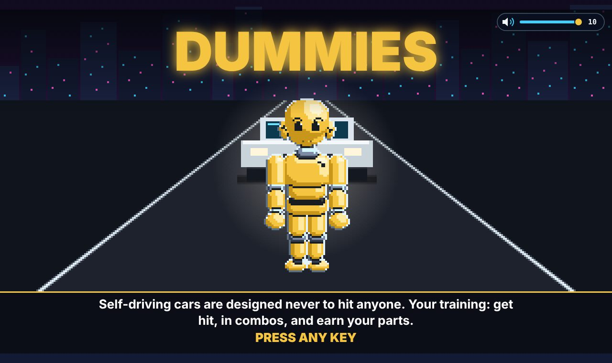

- **Music:** none yet
- No effect on this step.

## 2. the first press: audio unlocks, Track 1

- **Music:** intro · Track 1 (megabot)
- No effect on this step.

## 3. START: the mode select, Track 2

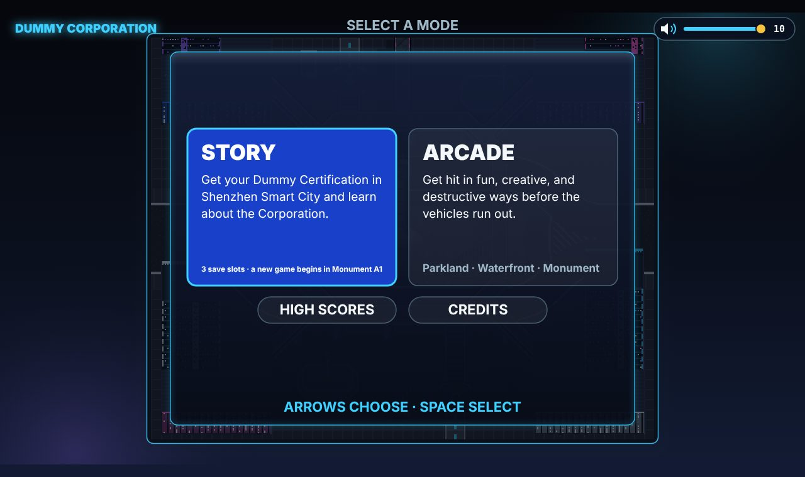

- **Music:** menu · Track 2 (summer nights)
- **`sfx.ui-start`** · START: `confirm_1.wav` · pool `confirm_1.wav` · alternates `select_5.wav`, `equip_2.wav`

## 4. cursor moves

- **Music:** menu · Track 2 (summer nights)
- **`sfx.ui-move`** · Cursor moves: `select_3.wav` ×2 · pool `select_3.wav` · alternates `select_1.wav`, `select_2.wav`

## 5. the Credits card

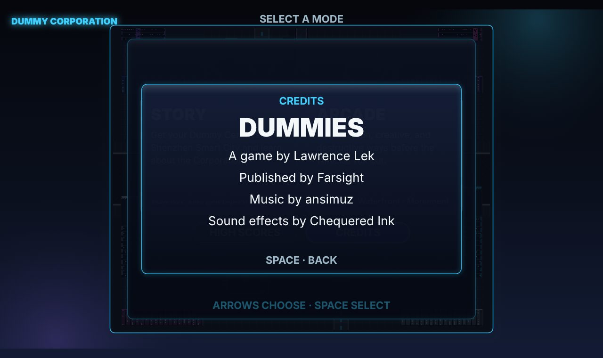

- **Music:** credits · Track 2 (summer nights)
- **`sfx.ui-move`** · Cursor moves: `select_3.wav` ×3 · pool `select_3.wav` · alternates `select_1.wav`, `select_2.wav`
- **`sfx.ui-ok`** · Confirm: `confirm_4.wav` · pool `confirm_4.wav` · alternates `confirm_1.wav`, `select_5.wav`

## 6. high scores

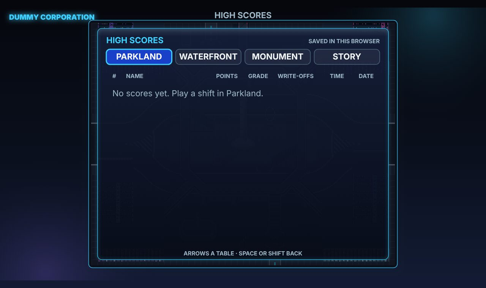

- **Music:** menu · Track 2 (summer nights)
- **`sfx.ui-back`** · Back: `cancel_3.wav` · pool `cancel_3.wav` · alternates `cancel_1.wav`, `cancel_2.wav`
- **`sfx.ui-move`** · Cursor moves: `select_3.wav` ×3 · pool `select_3.wav` · alternates `select_1.wav`, `select_2.wav`
- **`sfx.ui-ok`** · Confirm: `confirm_4.wav` · pool `confirm_4.wav` · alternates `confirm_1.wav`, `select_5.wav`

## 7. Arcade: district select

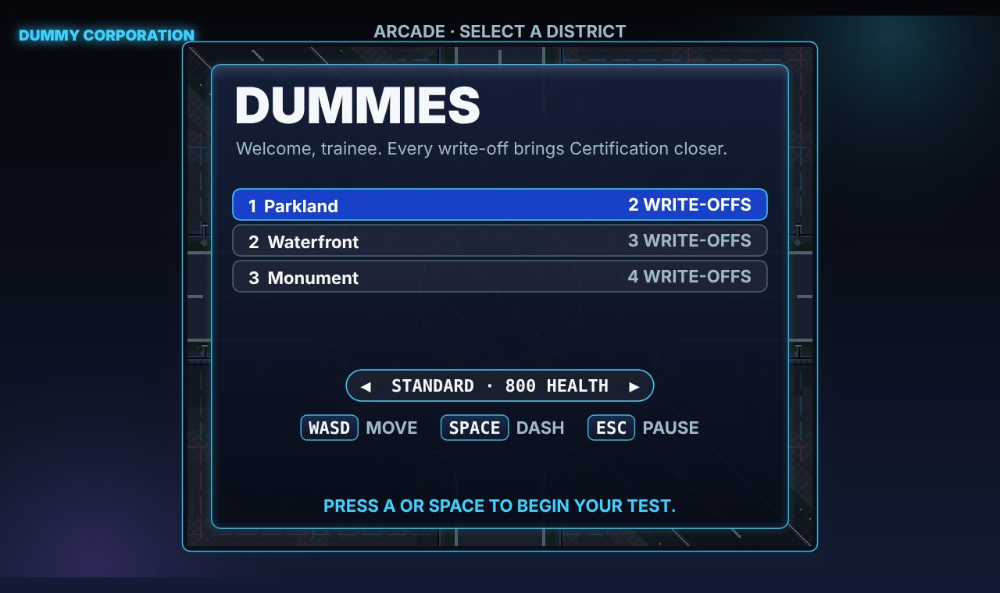

- **Music:** menu · Track 2 (summer nights)
- **`sfx.ui-back`** · Back: `cancel_3.wav` · pool `cancel_3.wav` · alternates `cancel_1.wav`, `cancel_2.wav`
- **`sfx.ui-move`** · Cursor moves: `select_3.wav` ×3 · pool `select_3.wav` · alternates `select_1.wav`, `select_2.wav`
- **`sfx.ui-ok`** · Confirm: `confirm_4.wav` · pool `confirm_4.wav` · alternates `confirm_1.wav`, `select_5.wav`

## 8. Arcade: the level card

- **Music:** menu · Track 2 (summer nights)
- **`sfx.ui-ok`** · Confirm: `confirm_4.wav` · pool `confirm_4.wav` · alternates `confirm_1.wav`, `select_5.wav`
- **`sfx.chassis`** · New chassis: `teleport.wav` · pool `teleport.wav` · alternates `powerup_3.wav`, `equip_2.wav`

## 9. Arcade: the drone drop, the level track

- **Music:** level · Track 3 (chibi robot b)
- **`sfx.ui-ok`** · Confirm: `confirm_4.wav` · pool `confirm_4.wav` · alternates `confirm_1.wav`, `select_5.wav`
- **`sfx.drop-in`** · Drone drop begins: `engine.wav` · pool `engine.wav` · alternates `ufo.wav`, `boost.wav`

## 10. Arcade: play

- **Music:** level · Track 3 (chibi robot b)
- **`sfx.bark`** · Bark bubble: `bubble.wav` · pool `bubble.wav`, `select_1.wav` · alternates `select_2.wav`, `computer_2.wav`
- **`sfx.dropped-in`** · Dummy set down: `land.wav` · pool `land.wav` · alternates `door_close.wav`, `blocked.wav`

## 11. Arcade: a dash

- **Music:** level · Track 3 (chibi robot b)
- **`sfx.lunge`** · Dash: `jump_4.wav` · pool `jump_4.wav` · alternates `shrink.wav`, `wobble.wav`

## 12. Arcade: a jump

- **Music:** level · Track 3 (chibi robot b)
- **`sfx.denied`** · Denied: `blocked.wav` · pool `blocked.wav` · alternates `cancel_2.wav`, `cancel_4.wav`

## 13. Arcade: a hit

- **Music:** level · Track 3 (chibi robot b)
- **`sfx.impact`** · Hit: `hurt_3.wav` · pool `hurt_1.wav`, `hurt_2.wav`, `hurt_3.wav`, `hurt_4.wav` · alternates `soft_destruction.wav`, `explosion_1.wav`

## 14. Arcade: a combo

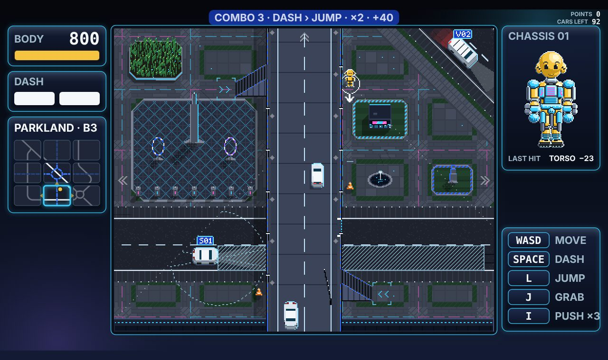

- **Music:** level · Track 3 (chibi robot b)
- **`sfx.combo`** · Combo: `collect_7.wav` · pool `collect_7.wav`, `collect_1.wav`, `collect_2.wav` · alternates `collect_5.wav`, `collect_6.wav`

## 15. Arcade: cones

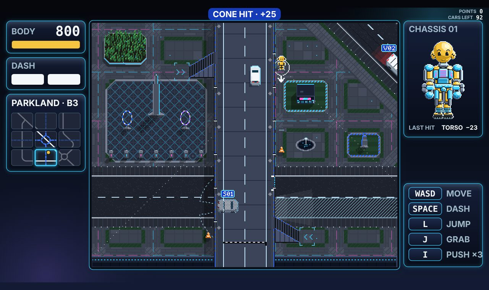

- **Music:** level · Track 3 (chibi robot b)
- **`sfx.pickup`** · Cone picked up: `collect_3.wav` · pool `collect_3.wav` · alternates `collect_4.wav`, `equip_1.wav`
- **`sfx.cone-hit`** · Cone hit: `explosion_2.wav` · pool `explosion_2.wav` · alternates `explosion_1.wav`, `harsh_destruction.wav`

## 16. drones

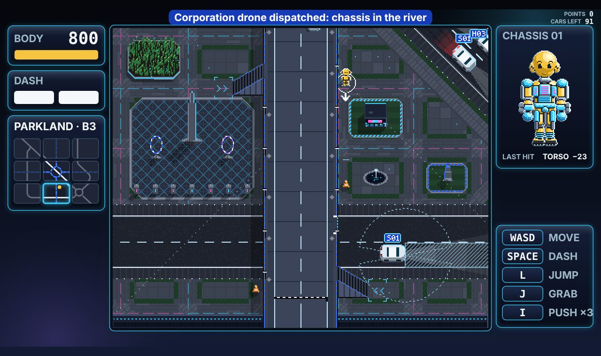

- **Music:** level · Track 3 (chibi robot b)
- **`sfx.drone-dispatch`** · Drone dispatched: `ufo.wav` · pool `ufo.wav` · alternates `engine.wav`, `computer_1.wav`
- **`sfx.drone-dispatch.rescue`** · To the river: `siren.wav` · pool `siren.wav` · alternates `ufo.wav`, `engine.wav`

## 17. Arcade: a write-off

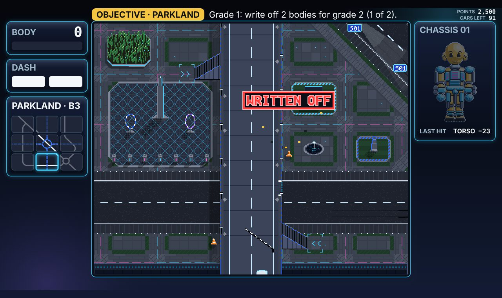

- **Music:** level · Track 3 (chibi robot b)
- **`sfx.writeoff`** · Write-off: `explosion_4.wav` · pool `explosion_4.wav` · alternates `explosion_3.wav`, `harsh_destruction.wav`
- **`sfx.credit`** · Credits paid: `collect_5.wav` · pool `collect_5.wav` · alternates `collect_6.wav`, `confirm_2.wav`

## 18. Arcade: the report

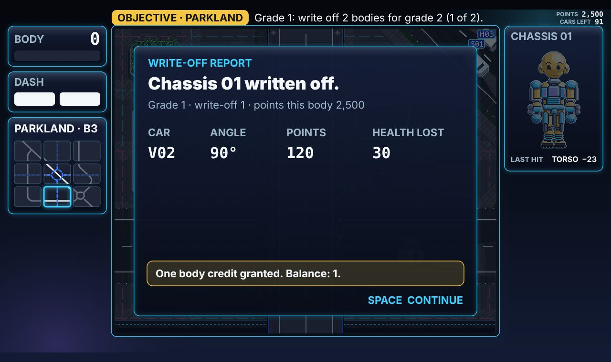

- **Music:** level · Track 3 (chibi robot b)
- No effect on this step.

## 19. Arcade: the workshop

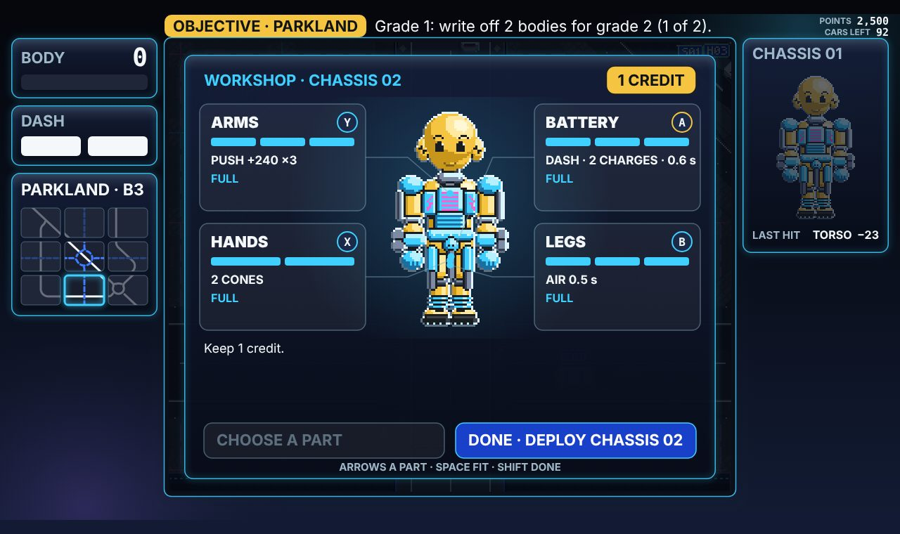

- **Music:** level · Track 3 (chibi robot b)
- **`sfx.ui-ok`** · Confirm: `confirm_4.wav` · pool `confirm_4.wav` · alternates `confirm_1.wav`, `select_5.wav`
- **`sfx.shop-open`** · Workshop opens: `select_5.wav` · pool `select_5.wav` · alternates `confirm_3.wav`, `equip_1.wav`

## 20. Arcade: a purchase

- **Music:** level · Track 3 (chibi robot b)
- **`sfx.ui-ok`** · Confirm: `confirm_4.wav` · pool `confirm_4.wav` · alternates `confirm_1.wav`, `select_5.wav`
- **`sfx.chassis`** · New chassis: `teleport.wav` · pool `teleport.wav` · alternates `powerup_3.wav`, `equip_2.wav`

## 21. pause: the music ducks

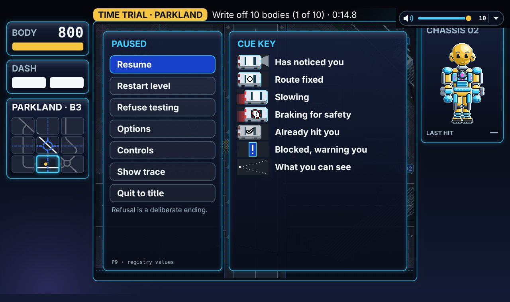

- **Music:** level · Track 3 (chibi robot b)
- **`sfx.jump`** · Jump: `jump_1.wav` · pool `jump_1.wav` · alternates `jump_3.wav`, `jump_2.wav`
- **`sfx.jump-land`** · Jump lands: `land.wav` · pool `land.wav` · alternates `blocked.wav`, `door_close.wav`
- **`sfx.ui-pause`** · Pause opens: `select_4.wav` · pool `select_4.wav` · alternates `cancel_4.wav`, `equip_1.wav`

## 22. Options: MUSIC, SOUND, MUTE

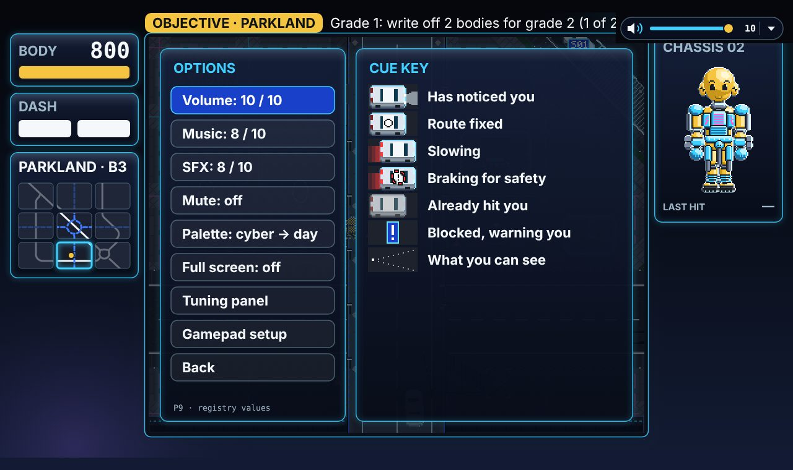

- **Music:** level · Track 3 (chibi robot b)
- **`sfx.ui-move`** · Cursor moves: `select_3.wav` ×3 · pool `select_3.wav` · alternates `select_1.wav`, `select_2.wav`
- **`sfx.ui-ok`** · Confirm: `confirm_4.wav` · pool `confirm_4.wav` · alternates `confirm_1.wav`, `select_5.wav`

## 23. Options: SOUND adjusted

- **Music:** level · Track 3 (chibi robot b)
- **`sfx.ui-move`** · Cursor moves: `select_3.wav` ×2 · pool `select_3.wav` · alternates `select_1.wav`, `select_2.wav`

## 24. resume

- **Music:** level · Track 3 (chibi robot b)
- **`sfx.ui-back`** · Back: `cancel_3.wav` ×2 · pool `cancel_3.wav` · alternates `cancel_1.wav`, `cancel_2.wav`
- **`sfx.ui-move`** · Cursor moves: `select_3.wav` ×3 · pool `select_3.wav` · alternates `select_1.wav`, `select_2.wav`

## 25. Arcade ends: Licensed

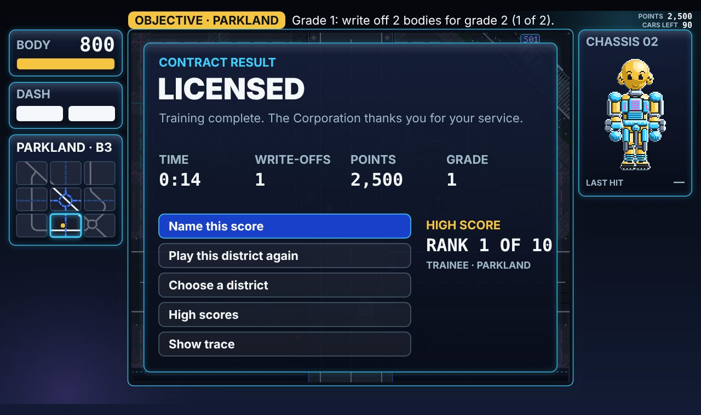

- **Music:** ending · Track 2 (summer nights)
- **`sfx.ending.win`** · Licensed or Certified: `powerup_5.wav` · pool `powerup_5.wav` · alternates `level_up.wav`, `powerup_1.wav`

## 26. back to the title

- **Music:** menu · Track 2 (summer nights)
- No effect on this step.

## 27. Story: save slots

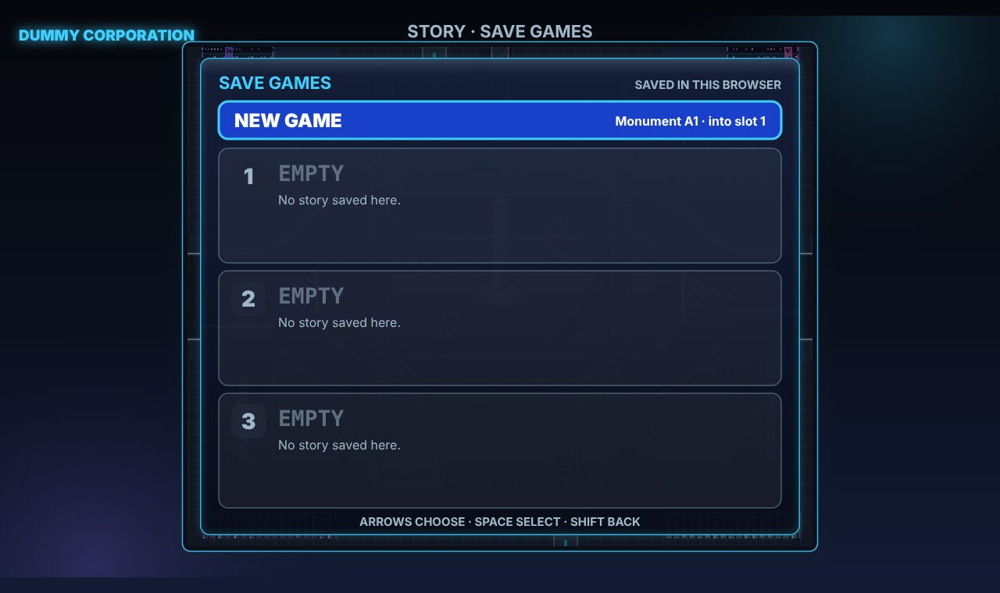

- **Music:** menu · Track 2 (summer nights)
- **`sfx.ui-ok`** · Confirm: `confirm_4.wav` · pool `confirm_4.wav` · alternates `confirm_1.wav`, `select_5.wav`

## 28. Story: the splash

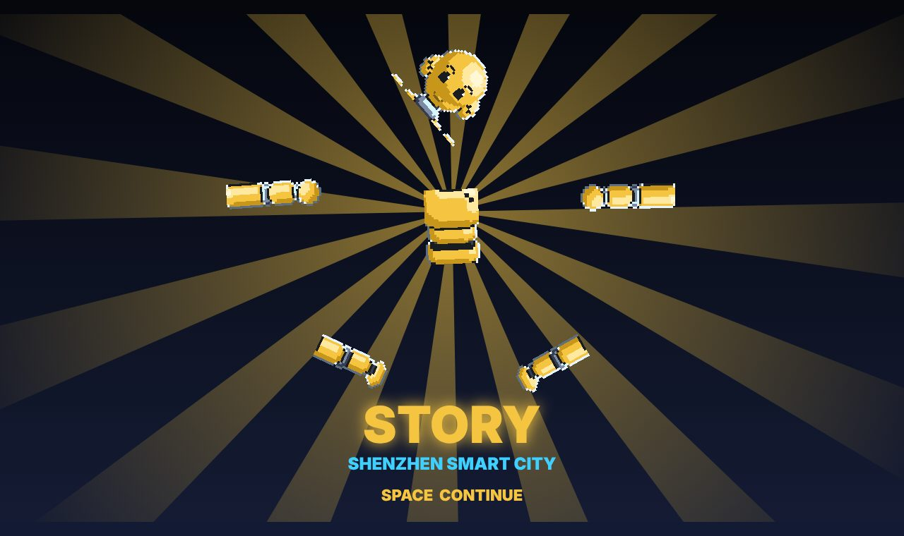

- **Music:** menu · Track 2 (summer nights)
- **`sfx.ui-ok`** · Confirm: `confirm_4.wav` · pool `confirm_4.wav` · alternates `confirm_1.wav`, `select_5.wav`

## 29. Story: the map

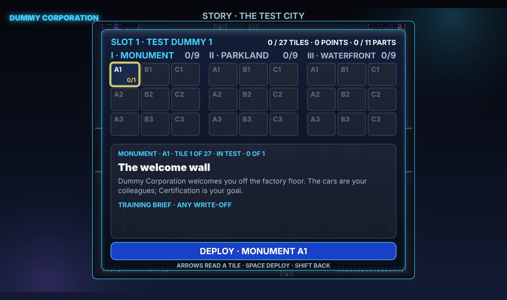

- **Music:** menu · Track 2 (summer nights)
- **`sfx.ui-ok`** · Confirm: `confirm_4.wav` · pool `confirm_4.wav` · alternates `confirm_1.wav`, `select_5.wav`

## 30. Story: the level card (A1)

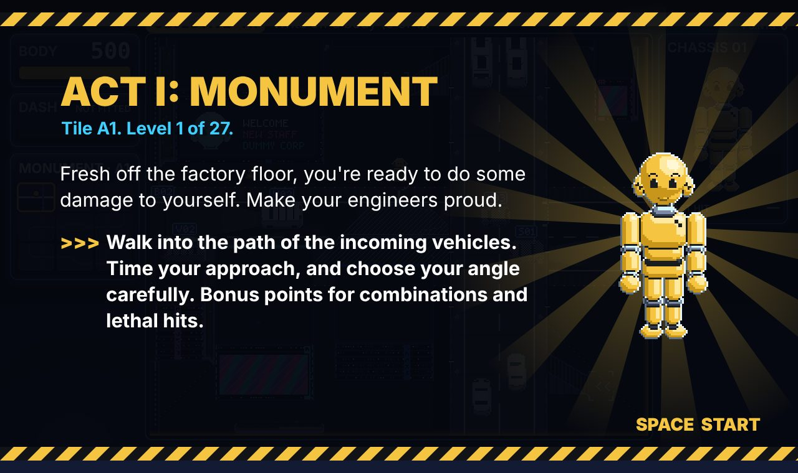

- **Music:** menu · Track 2 (summer nights)
- **`sfx.ui-ok`** · Confirm: `confirm_4.wav` · pool `confirm_4.wav` · alternates `confirm_1.wav`, `select_5.wav`
- **`sfx.chassis`** · New chassis: `teleport.wav` · pool `teleport.wav` · alternates `powerup_3.wav`, `equip_2.wav`
- **`sfx.story-enter`** · Tile in test: `computer_1.wav` · pool `computer_1.wav` · alternates `computer_2.wav`, `chime.wav`

## 31. Story: the drone drop

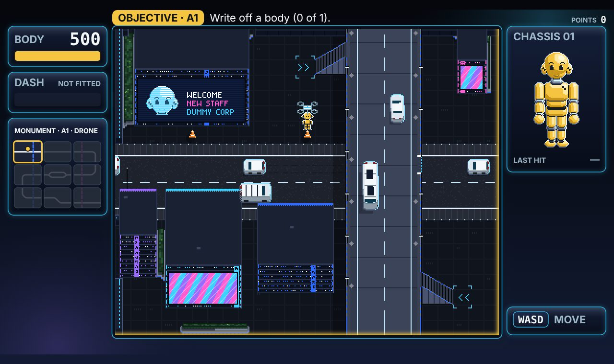

- **Music:** level · Track 3 (chibi robot b)
- **`sfx.ui-ok`** · Confirm: `confirm_4.wav` · pool `confirm_4.wav` · alternates `confirm_1.wav`, `select_5.wav`
- **`sfx.drop-in`** · Drone drop begins: `engine.wav` · pool `engine.wav` · alternates `ufo.wav`, `boost.wav`

## 32. Story: play on tile 1

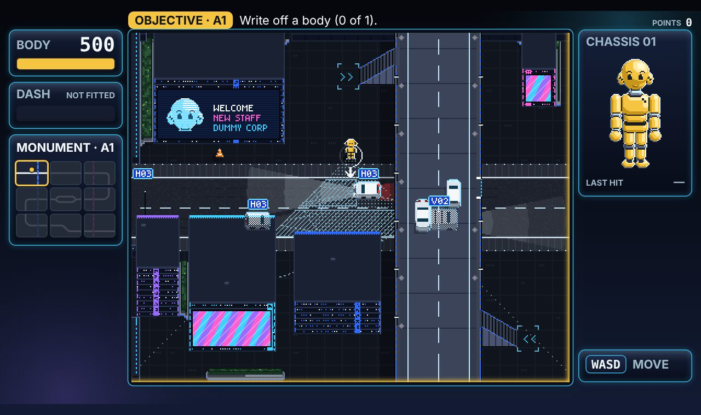

- **Music:** level · Track 3 (chibi robot b)
- **`sfx.dropped-in`** · Dummy set down: `land.wav` · pool `land.wav` · alternates `door_close.wav`, `blocked.wav`

## 33. Story: a dash

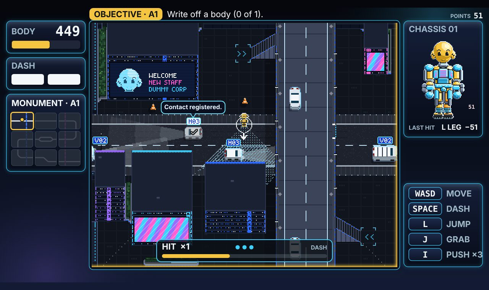

- **Music:** level · Track 3 (chibi robot b)
- **`sfx.lunge`** · Dash: `jump_4.wav` · pool `jump_4.wav` · alternates `shrink.wav`, `wobble.wav`
- **`sfx.bark`** · Bark bubble: `select_1.wav` · pool `bubble.wav`, `select_1.wav` · alternates `select_2.wav`, `computer_2.wav`
- **`sfx.impact`** · Hit: `hurt_4.wav` · pool `hurt_1.wav`, `hurt_2.wav`, `hurt_3.wav`, `hurt_4.wav` · alternates `soft_destruction.wav`, `explosion_1.wav`

## 34. Story: a jump

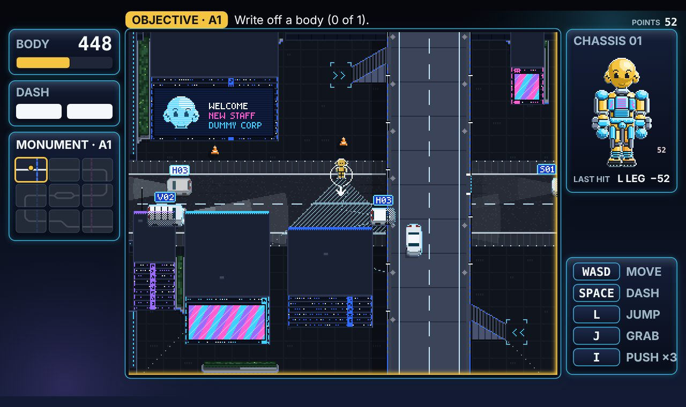

- **Music:** level · Track 3 (chibi robot b)
- **`sfx.jump`** · Jump: `jump_1.wav` · pool `jump_1.wav` · alternates `jump_3.wav`, `jump_2.wav`

## 35. Story: a big hit

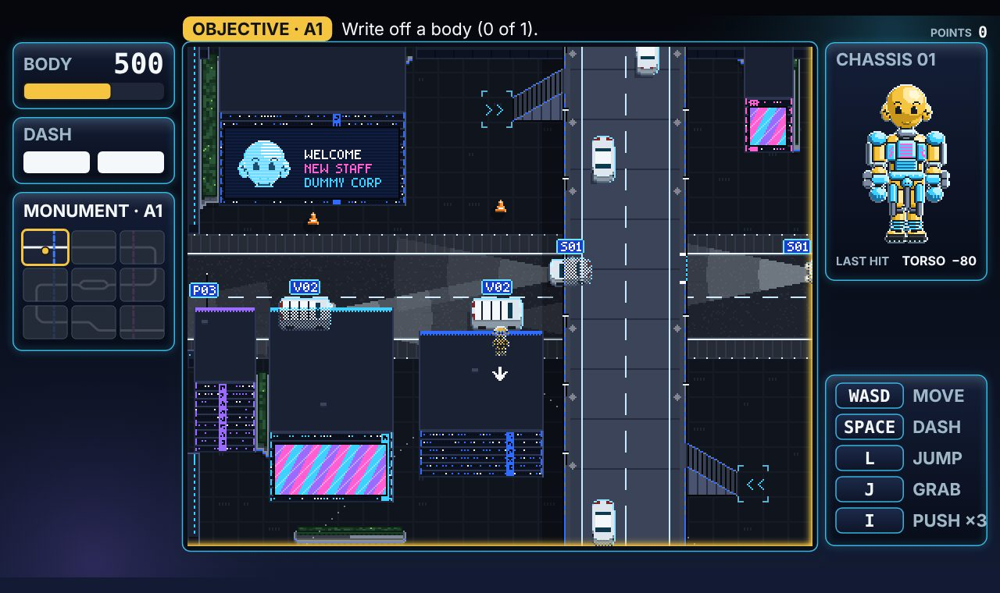

- **Music:** level · Track 3 (chibi robot b)
- **`sfx.jump-land`** · Jump lands: `land.wav` · pool `land.wav` · alternates `blocked.wav`, `door_close.wav`
- **`sfx.impact.big`** · A big hit: `explosion_1.wav` · pool `harsh_destruction.wav`, `explosion_1.wav` · alternates `explosion_2.wav`, `soft_destruction.wav`

## 36. Story: counted, cleared

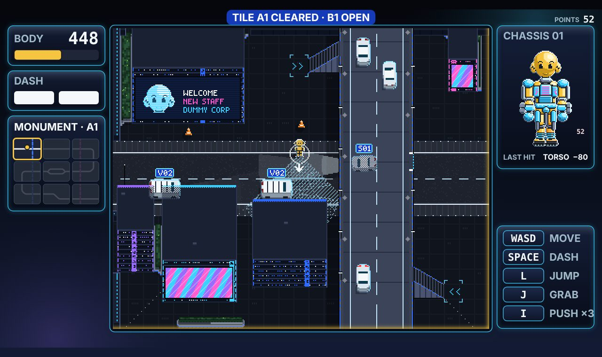

- **Music:** level · Track 3 (chibi robot b)
- **`sfx.story-deliver`** · Delivery drone: `engine.wav` · pool `engine.wav` · alternates `ufo.wav`, `boost.wav`
- **`sfx.story-count`** · Counted: `stat_increase.wav` · pool `stat_increase.wav` · alternates `collect_5.wav`, `confirm_2.wav`
- **`sfx.story-clear`** · Tile cleared: `powerup_5.wav` · pool `powerup_5.wav` · alternates `level_up.wav`, `powerup_1.wav`

## 37. Story: the gift screen

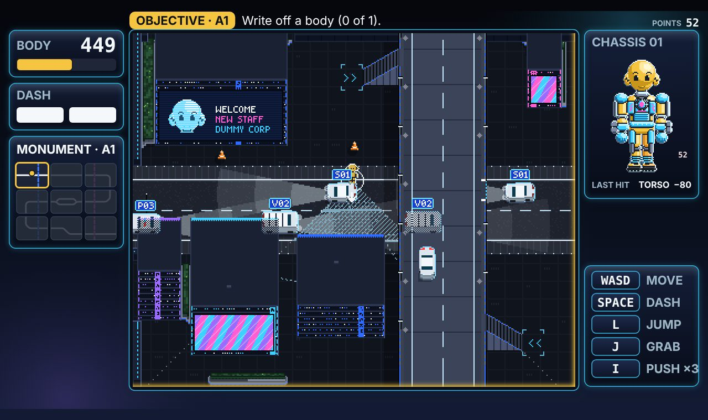

- **Music:** level · Track 3 (chibi robot b)
- **`sfx.gift`** · Gift screen: `powerup_5.wav` · pool `powerup_5.wav` · alternates `powerup_3.wav`, `level_up.wav`

## 38. Story: the report

- **Music:** level · Track 3 (chibi robot b)
- **`sfx.bark`** · Bark bubble: `bubble.wav` · pool `bubble.wav`, `select_1.wav` · alternates `select_2.wav`, `computer_2.wav`
- **`sfx.writeoff`** · Write-off: `explosion_4.wav` · pool `explosion_4.wav` · alternates `explosion_3.wav`, `harsh_destruction.wav`
- **`sfx.story-count`** · Counted: `stat_increase.wav` · pool `stat_increase.wav` · alternates `collect_5.wav`, `confirm_2.wav`
- **`sfx.story-clear`** · Tile cleared: `powerup_5.wav` · pool `powerup_5.wav` · alternates `level_up.wav`, `powerup_1.wav`

## 39. Story: the ferry to the next tile

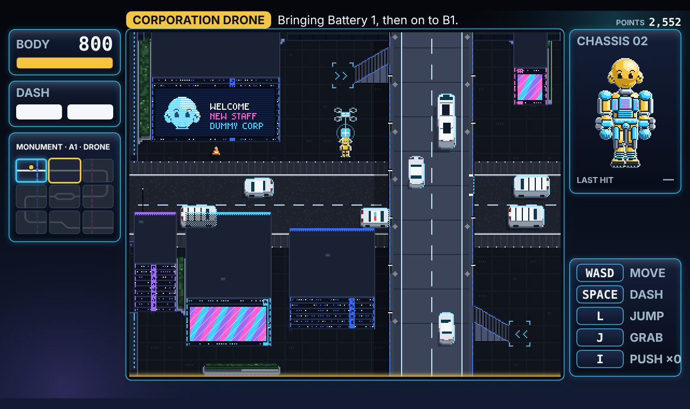

- **Music:** level · Track 3 (chibi robot b)
- **`sfx.ui-ok`** · Confirm: `confirm_4.wav` · pool `confirm_4.wav` · alternates `confirm_1.wav`, `select_5.wav`
- **`sfx.chassis`** · New chassis: `teleport.wav` · pool `teleport.wav` · alternates `powerup_3.wav`, `equip_2.wav`
- **`sfx.story-ferry`** · Ferry: `ufo.wav` · pool `ufo.wav` · alternates `engine.wav`, `teleport.wav`

## 40. Story: the gift screen (ferry)

- **Music:** level · Track 3 (chibi robot b)
- **`sfx.gift`** · Gift screen: `powerup_5.wav` · pool `powerup_5.wav` · alternates `powerup_3.wav`, `level_up.wav`
- **`sfx.story-gift`** · Credit gift: `collect_6.wav` · pool `collect_6.wav` · alternates `collect_5.wav`, `chime.wav`

## 41. Story: the next card

- **Music:** level · Track 4 (happywalking)
- **`sfx.ui-ok`** · Confirm: `confirm_4.wav` · pool `confirm_4.wav` · alternates `confirm_1.wav`, `select_5.wav`
- **`sfx.story-enter`** · Tile in test: `computer_1.wav` · pool `computer_1.wav` · alternates `computer_2.wav`, `chime.wav`

## 42. Story: play on tile 2: the next level track

- **Music:** level · Track 4 (happywalking)
- **`sfx.ui-ok`** · Confirm: `confirm_4.wav` · pool `confirm_4.wav` · alternates `confirm_1.wav`, `select_5.wav`

## 43. the finale: the plaque, Track 1

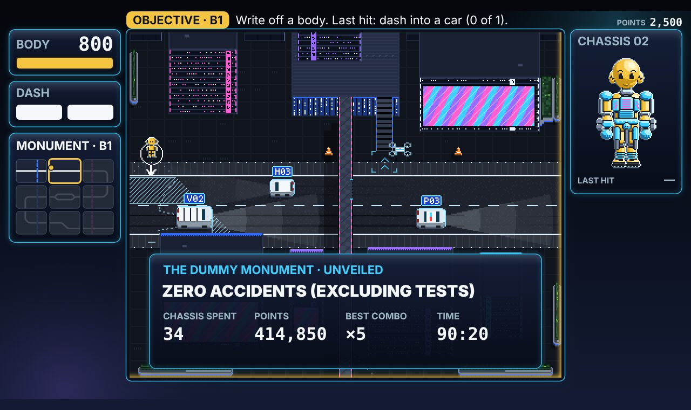

- **Music:** finale · Track 1 (megabot)
- **`sfx.unveil`** · Unveiling: `powerup_1.wav` · pool `powerup_1.wav` · alternates `powerup_3.wav`, `level_up.wav`
- **`sfx.unveil-lift`** · Cloth lifts: `disappear.wav` · pool `disappear.wav` · alternates `teleport.wav`, `shrink.wav`

## 44. CERTIFIED

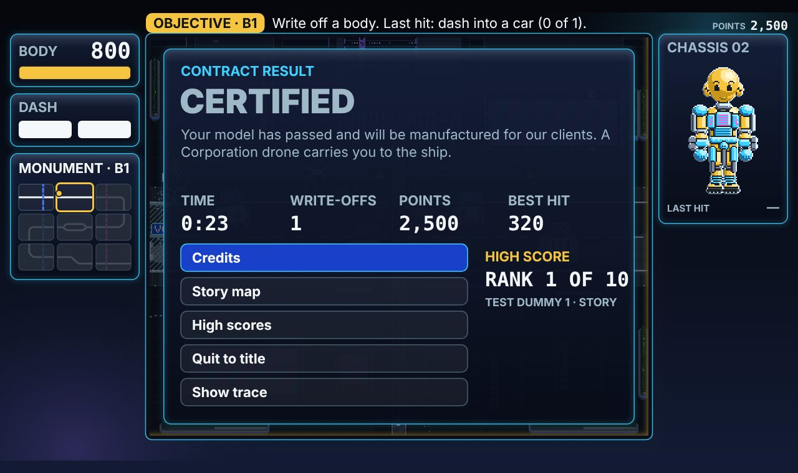

- **Music:** finale · Track 1 (megabot)
- **`sfx.ending.win`** · Licensed or Certified: `powerup_5.wav` · pool `powerup_5.wav` · alternates `level_up.wav`, `powerup_1.wav`

